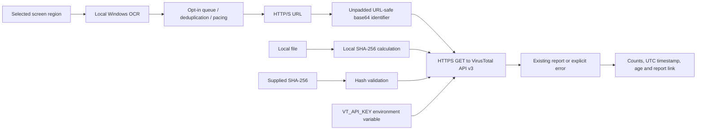

# LinkScope — URL & File Reputation

A Windows desktop application with a Python command-line utility for retrieving existing VirusTotal URL and file reports. It supports investigation by presenting detection counts, report age and a report link. It does not decide whether a link is safe to open.

## Desktop application

Double-click **Launch LinkScope.vbs**, or run `python app.py` in this folder. Python must be available on PATH; the GUI also requires Tkinter. The CLI filename `vtcheck.py` remains for compatibility.

1. Click **Try demo** to inspect synthetic results without an API key.
2. For live reports, open **API settings** and enter your key in the masked session-only field, or use `VT_API_KEY`.
3. Use the manual URL, SHA-256 or local file controls for individual lookups.
4. Click **Select region** and drag a rectangle around public link text on the primary display. Escape cancels selection. Move LinkScope outside that rectangle.
5. Click **Start** for local OCR every five seconds. Two enlarged OCR passes must agree, and the URL must appear in two consecutive captures before it enters the lookup queue. To look up recognized links automatically, enable the automatic-send switch before starting and acknowledge the disclosure prompt.
6. Click **Stop**, press Escape while LinkScope has focus, or close the application to stop monitoring. Escape is not a system-wide hotkey. An already dispatched request/capture may finish; results from obsolete capture sessions are discarded.

Monitoring is off at every launch. Screenshots and full OCR text are processed in memory and never written to disk or uploaded. Detected URLs and report results remain in application memory until exit; ordinary OS memory/swap handling still applies. Region coordinates are fixed screen coordinates, not attached to a window: moving other windows into that rectangle changes what is captured.

Automatic lookup is conservative: only explicit `http://` or `https://` text is recognized; query strings, fragments, embedded credentials and obvious private hosts are excluded from automatic submission. **This is not a complete confidentiality filter:** secrets may appear in URL paths and public-looking hostnames can be internal. Monitor only content you are authorized to disclose. OCR may misread, truncate or miss a URL and cannot inspect the hidden target of a hyperlink. It does not evaluate every download on a page.

Eligible links are deduplicated for the application session. The queue holds at most 50 links, the seen set 500, and result history 500 rows. Overflow requires a manual lookup. Stopping clears the queue. Starting again resets detected-link deduplication so visible links can be checked again; request pacing and the session cap remain in force. Manual and automatic requests share a 16-second interval and a 100-request session cap. These are local limits, not account-wide daily quota enforcement. Lookup errors stop automatic monitoring. Changing the automatic-send option also stops monitoring until Start is pressed again.

The monitor requires Windows 10/11, Windows PowerShell, and an installed Windows OCR language matching your user profile. No OCR service account or Python package installation is needed. The selector currently supports the primary display; multi-monitor and mixed-DPI behavior are not validated. If recognition fails, check Windows language settings and include padding around the full URL. Corporate script restrictions may block the local OCR helper; do not bypass organizational controls.

Technical references: [Windows OCR](https://learn.microsoft.com/en-us/uwp/api/windows.media.ocr.ocrengine) and [Tkinter](https://docs.python.org/3.14/library/tkinter.html). Region capture uses Windows System.Drawing; the bundled PowerShell helper returns recognized text over a local process pipe.

## Architecture



The local program never visits the supplied URL, downloads its contents, executes a local file, or uploads a file. Automatic monitoring and CLI commands retrieve existing reports. A separate confirmed desktop action can request URL analysis by VirusTotal. Each CLI invocation makes at most one API request, with a 20-second network timeout and no automatic retry. Redirects are blocked so API credentials cannot be forwarded to another host.

## Quick start: offline

Requires Python 3.11 or later; local verification uses Python 3.14. No packages need installing. Open PowerShell in this folder:

```powershell
python -m unittest discover -s tests -v
python demo.py
python vtcheck.py --help
```

The demo uses **synthetic fixtures**, makes no network requests and needs no API key. Its fixed reference clock makes the output reproducible. Invented report links are omitted from demo output.

## Live setup

Obtain your own API key through your VirusTotal account. Set it locally, never in a GitHub file or chat. This PowerShell prompt avoids including the value in command history:

```powershell
$vtSecret = Read-Host 'VirusTotal API key' -AsSecureString
$env:VT_API_KEY = [System.Net.NetworkCredential]::new('', $vtSecret).Password
Remove-Variable vtSecret
```

The running process and child processes can read this environment variable. The tool does not write it to disk. It does not automatically load `.env` files.

Examples (each performs a real lookup and consumes quota):

```powershell
python vtcheck.py url 'https://example.com/'
python vtcheck.py file 'C:\path\to\your\lab-sample.txt'
python vtcheck.py --json hash 'ba7816bf8f01cfea414140de5dae2223b00361a396177a9cb410ff61f20015ad'
```

Replace the file path with a file you control. The example hash is SHA-256 of the bytes `abc`, not a claim about a live VirusTotal report. Place `--json` before the subcommand. Shell-quote URLs containing `&` or other shell characters.

**Privacy:** URL lookup sends the entire supplied URL, including query strings, to VirusTotal. Base64 is reversible encoding, not encryption. Do not use confidential links, password-reset tokens, signed download links, employer data or private incident indicators. File lookup sends a hash, which can identify known contents; it does not send the filename, local path or file bytes. JSON output contains the lookup identifier, so keep real reports private under ignored `local-results/`.

The [Public API documentation](https://docs.virustotal.com/reference/public-vs-premium-api), checked 2026-11-10, specifies 4 requests per minute and 500 per day. It prohibits commercial products/services and business workflows that do not contribute new files. This repository is a personal portfolio implementation, not authorization to deploy it in an employer workflow. Account-specific permissions and applicable terms still apply. Space manual requests at least 15 seconds apart; the CLI does not coordinate quotas across processes or other applications.

## Interpreting results

| Result | Meaning | Next step |
| --- | --- | --- |
| `detections_reported` | At least one malicious or suspicious engine count | Review report age, engines, sender/source and surrounding evidence |
| `no_detections_reported` | Both relevant counts are present and zero, with some reported results | Do not treat this as clearance to open or execute |
| `unknown` | Report missing or insufficient counts | Gather other evidence; no scan is automatically submitted |
| `error` | Input, authentication, transport or response validation failed | Resolve the specific error before interpreting reputation |

Counts are engine observations, not independent votes or a probability of compromise. False positives and false negatives are possible. Old reports may not reflect current URL content. A URL report does not establish the safety of a file it links to; inspect that file's hash separately. A file hash identifies the bytes read at lookup time; avoid changing a file during hashing. This utility provides no browser interception, download blocking, download interception or malware sandbox.

Exit codes describe execution: **0** report found (including flagged reports), **1** not found, **2** error. Never use exit code 0 as a safety verdict.

## Troubleshooting and cleanup

- Missing key: set `VT_API_KEY` in the same terminal running Python.
- HTTP 401/403: check key validity and account access; do not paste credentials into an issue.
- HTTP 429: stop requests and wait for the applicable quota to reset. There are no retries or quota-bypass mechanisms.
- HTTP 404: no existing report was returned; the result remains unknown.
- Network/timeout: check connectivity. The program uses Python's normal HTTPS certificate checks and proxy environment configuration; it does not disable TLS verification.
- Invalid JSON/schema: retain a sanitized description for diagnosis, not raw confidential responses. The CLI does not print API response bodies.
- Future timestamp: check your clock and report metadata. Missing dates are shown as unknown rather than invented.

Remove the session key when finished:

```powershell
Remove-Item Env:VT_API_KEY -ErrorAction SilentlyContinue
```

There are no installed services, cloud resources or third-party Python dependencies to remove. The desktop screen monitor uses Windows built-in OCR. Optional exported reports under `local-results/` can be removed manually. Rotate a key through your account if it is exposed.

## Engineering evidence

Tests cover hash correctness including empty/multi-chunk files, URL encoding, invalid inputs, GET-only requests, redirect blocking, missing credentials, HTTP errors, timeout handling, response limits, malformed data, report interpretation and CLI behavior. CI is configured to run tests and the offline demo on Windows and Ubuntu without secrets or live API calls.

See [verification](docs/verification.md), [data contract](docs/data-contract.md) and the [synthetic investigation](docs/investigation.md). Skills demonstrated include API integration, SHA-256 hashing, defensive input handling, reputation triage and repeatable testing. The project supplements the local file integrity checker: integrity compares bytes over time; this tool retrieves reputation evidence for specific bytes or URLs.

## API references

- [URL report GET endpoint](https://docs.virustotal.com/reference/url-info)
- [URL identifier encoding](https://docs.virustotal.com/reference/url)
- [File report GET endpoint](https://docs.virustotal.com/reference/file-info)
- [File object fields](https://docs.virustotal.com/reference/files)

API instructions checked against these official references on 2026-11-10. Implementation deliberately accepts SHA-256 only, although the API also supports other file hash types.

### Browser address-bar troubleshooting

The OCR detector requires the full `http://` or `https://` address. Browsers may display only a hostname. Focus the address bar with Ctrl+L to reveal the full address, or display it in Notepad using a large font. Keep the selected rectangle unobstructed. The desktop interface now reports whether it recognized no text, text without a full URL, or one or more URLs, without displaying unrelated captured text. Restart an already-open application to load code updates; re-enter your session-only API key afterward.

### Reading the desktop results

**Not checked · Auto checks off** means a URL was detected locally but has not been sent for a reputation lookup. It is not a malicious verdict. Select the row and choose **Check selected link**, or enable automatic checks and restart monitoring. **Privacy hold** means the automatic-send filter held the link; individual checking requires confirmation. **Queue full** means automatic work exceeded the pending capacity. Results replace the existing row for the same displayed indicator. The details panel explains evidence and next steps in plain language; CLI JSON output remains available.

### Recognition accuracy and controlled testing

Select the **whole address with about 10 pixels of space on every side**, not the smallest possible rectangle. Cropped characters cannot be restored by enlargement. Keep the address unobstructed and show the full `https://` scheme. Avoid moving windows into the selected area. Allow roughly 10–20 seconds for two captures, plus any request pacing and API latency.

The OCR helper enlarges the selected image at 2× and 3× (limited by Windows OCR's maximum dimensions) and adds artificial border padding without reading outside the selected region. Different URL readings, text touching image edges, and URL lines with spaces are held. Recognition does not guess missing schemes or silently join separated path fragments. These conservative checks may reject readable text containing adjacent words; use direct paste for an exact lookup. Two matching readings reduce some mistakes but cannot guarantee correctness: both passes can make the same mistake, and a truncated browser display can look complete.

Run `python screen_smoke.py` on Windows for a controlled test. It temporarily displays a sample window, captures only its text, and exercises the automatic lookup through a mocked API. It does not use your key or make live requests. `python gui_smoke.py` tests UI flow without screen capture. Keep the sample window visible during the screen test. Results depend on font rendering, display scaling and installed OCR language support.

### Submit a URL with no report

When a URL lookup returns **No existing report**, select that row and click **Submit URL for analysis**. Review the exact URL in the confirmation (OCR can be wrong) and confirm only public content you are authorized to submit. VirusTotal may visit the URL and include it in its community dataset. The [official submission documentation](https://docs.virustotal.com/reference/scan-url) also warns about dataset inclusion for queried indicators; do not use confidential indicators for either lookup or submission.

Submission uses POST `/api/v3/urls` and returns an analysis ID. **Submitted** means accepted, not completed. The button changes to **Refresh analysis**, which uses GET `/api/v3/analyses/{id}`. Wait at least 16 seconds between requests. Refresh manually until the state becomes **completed**; queued/in-progress states remain unknown. Refreshing never resubmits the URL. All requests share the existing pacing and session limits. There is no automatic polling and no automatic submission from screen monitoring.

If submission fails or times out, it may already have reached VirusTotal. The app prevents another submission for that URL during the session and does not retry. If an analysis ID was received, refresh remains available after a refresh error. Otherwise use an existing-report lookup later. Analysis IDs are kept only in memory and are lost on exit. Closing the app or stopping screen capture does not cancel a server-side analysis. File uploads remain unsupported. The CLI remains lookup-only.

References: [submit URL](https://docs.virustotal.com/reference/scan-url), [retrieve analysis](https://docs.virustotal.com/reference/analysis), [analysis states and fields](https://docs.virustotal.com/reference/analyses-object). Verified against official documentation on 2026-11-17.

### Monitoring and request indicators

The header always shows **MONITORING** or **STOPPED**. A moving activity bar indicates enabled screen monitoring, not a completed scan or percentage of API progress. Screen activity shows the next-read countdown, completed read count and last read time. A separate API line shows in-flight work, seconds until the next request, requests used and queue length. These displays remain visible when result messages change.

A new URL appears as **Confirming URL · Read 1 of 2**, then **Waiting for lookup**, then **Checking existing report…**, then its result. Each row has an update time. Repeated links are deduplicated; the reader explicitly says it is watching for a different link. Request buttons are disabled during an in-flight request or cooldown. A session limit has its own message rather than being confused with the 16-second interval.

The reader ignores OCR text before an explicit http(s) scheme, such as a browser address-bar icon. It still rejects spaces inside the URL/path, inconsistent OCR passes and edge-clipped text. No missing URL characters are guessed. The screen test now switches between two URLs and verifies both automatic lookups while maintaining real request pacing, using a mocked API.
